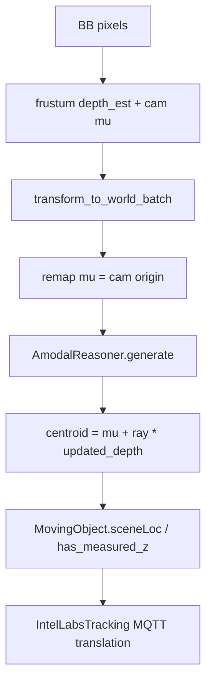

<!--
SPDX-FileCopyrightText: (C) 2026 Intel Corporation
SPDX-License-Identifier: Apache-2.0
-->

# Debug plan + findings: Stairs observation Z offset

**Environment (findings)**: live `scenescape-scene-1` + Stairs DLStreamer (stair-cam-1/2), 2026-10-23.

Instrumentation in [`observation_pipeline.py`](controller/src/controller/observation_pipeline.py):

- Stage A–F logs when `/tmp/observation_pipeline_debug` exists (or `OBSERVATION_PIPELINE_DEBUG=1`)
- Mode switch via `/tmp/observation_pipeline_mode` = `full` | `frustum_only` | `off`

## Goal

Find **which stage** introduces the multi-meter Z error on Stairs (Phase 1 path), without changing production logic until the stage is identified. Work top-down: characterize → isolate pipeline vs tracker → bisect frustum vs amodal → check frame/calibration conventions.

Relevant path (already shipped):



Key code: [`observation_pipeline.py`](controller/src/controller/observation_pipeline.py), [`frustum_gaussian/__init__.py`](scene_common/src/frustum_gaussian/__init__.py), [`amodal_reasoner.py`](scene_common/src/observation_conditioning/amodal_reasoner.py), [`ilabs_tracking.py`](controller/src/controller/ilabs_tracking.py) (`zMeasured` from `has_measured_z`).

### Confirmed amodal contracts (do not second-guess during bisect)

From [`AmodalReasoner.generate`](scene_common/src/observation_conditioning/amodal_reasoner.py):

- **`mu` must be camera world origin**, not the object mean. Centroid is always `mu + ray * depth`. Passing frustum’s world object `mu` into `generate` would displace the point by ~`depth_est` meters.
- **`updated_depth` is along-ray range from that `mu`** (same units as frustum `depth_est`), after occluder/wall truncation of the depth Gaussian — not a direct floor hit and **not** an independent height prior.
- FREE_3D / no bounds → `updated_depth = depth_est` (passthrough). Amodal does **not** snap Z to floor via a height offset; world-up only orients probes/pin-drops.

Current pipeline already remaps `mu` to `pose_mat[:3,3]` before `generate`. Step 2D still verifies this at runtime (regressions here look like multi-meter Z).

---

## Step 0 — Characterize the symptom (5–10 min)

Before touching code, freeze what “off” means. Sample MQTT on `scenescape/data/scene/<stairs_uid>/person` for a person standing on a known landing (or known step height).

Record for **≥20 frames**, separately for `stair-cam-1` and `stair-cam-2` when visible alone:

| Field | Capture |
|-------|---------|
| Sign | Z too high vs too low vs oscillating |
| Magnitude | median \|ΔZ\| in meters vs expected floor height |
| Constant vs depth-dependent | ΔZ ≈ constant (pose/mesh frame) vs grows with range (depth/prior) |
| Per-camera | same ΔZ on both cams → world/mesh; only one cam → that cam K/pose/intrinsics |
| Detection vs track | compare raw conditioned point (Step 2 logs) vs MQTT `translation[2]` |

**Interpretation cheat sheet:**

- ~0.7–1.0 m high, constant → likely **centroid vs foot** (body center published; UI/ground truth is feet). Legacy path projects the **foot** of the BB onto the plane ([`mapObjectDetectionToWorld`](controller/src/controller/moving_object.py)).
- 2–5+ m, roughly constant in world → **mesh frame / camera pose Z / world-up axis**.
- Grows with distance or BB size → **shape prior / intrinsics / frustum depth**.
- Only after amodal (prior OK, updated bad) → **mesh conditioning / wrong surface hit**.

### Findings (Step 0)

| Metric | Value |
|--------|-------|
| Sign | World Z of conditioned centroids is **near floor / slightly above** (~0.0–1.3 m), not near camera height (~2.2 m) |
| Magnitude vs expected torso on floor (floor≈0 + 0.85) | Upper-body samples ≈ **+0.4 m** (H1 band); some lower-image BBs ≈ **0.0–0.3 m** (near feet / shallow) |
| Constant vs depth-dependent | Depths ~3.8–4.4 m stable; Z variation tracks ray dip more than range |
| Per-camera | Both cams agree on world XY≈(3.8, 5.3) and Z≈1.28 for the upper person |
| Detection vs track | Stage F is pre-tracker; amodal Δdepth = 0 so tracker sees frustum centroid |

Representative sample (`stair-cam-2`, full mode):

| Stage | Value |
|-------|-------|
| A | BB=(872,84,148,343), K=(978.74,978.74,640,360), 1280×720, cam_origin≈(1.31, 8.29, 2.24) |
| B | depth_est=4.004, lo=3.265, hi=5.337, score=0.996, edge_valid=15 |
| C | world_mu≈(3.84, 5.33, 1.29), ray≈(0.63, -0.74, -0.24) |
| D | mu_remap_err=0 (mu = cam origin) |
| E | updated_depth=4.004, **delta_depth=0.000** |
| F | centroid≈(3.84, 5.33, 1.29), prior_half_height=0.85 |

---

## Step 1 — Confirm the Stairs path is the one producing Z

1. In controller logs, confirm `ObservationPipeline: built AmodalReasoner for stair-cam-*` and conditioned-detection debug.
2. Temporarily disable the gate for one run (or rename scene off allow-list) and compare MQTT Z:
   - Gate off → legacy ground projection (often Z≈0 / planar).
   - Gate on → measured Z path.
3. If the bad Z only appears with the gate on, the bug is in observation conditioning (or how tracks consume it), not DLStreamer.

Do **not** change tracker association yet; only isolate.

### Findings (Step 1)

- Logs: `ObservationPipeline: built AmodalReasoner for stair-cam-1/2 … mode=full`
- Stairs gate active; conditioning runs before tracker.

---

## Step 2 — Instrument one detection through the pipeline (binary bisect)

Add temporary debug logging (or enable `AmodalReasoner.debug = True`) for a **single** camera and **one** stable BB. Log these quantities in [`ObservationPipeline.apply`](controller/src/controller/observation_pipeline.py) immediately after each stage:

| Stage | Fields | What “good” looks like |
|-------|--------|------------------------|
| A. Inputs | `cam_id`, BB xywh, `fx,fy,cx,cy,width,height`, `pose_mat[:3,3]` (cam origin), pose Z | Cam origin Z matches UI/calibration; resolution matches DLStreamer frame |
| B. Frustum (cam) | `depth_est`, `depth_lo/hi`, `mu_cam` (z), `score`, `edge_valid` | Depth ≈ expected range to person; not clip-driven `depth_lo=0` chaos |
| C. Frustum (world, before remap) | `world_obs["mu"]` XYZ, `ray`, `depth_est` | World centroid Z ≈ floor_z + ~0.85 m for standing adult (centroid), not floor or ceiling |
| D. Remap check | `gaus_rays["mu"]` vs `pose_mat[:3,3]`; also compare to `world_obs["mu"]` | `gaus_rays["mu"]` must equal cam origin; if it equals world object mean instead, expect ~range-scale Z error |
| E. Amodal | `depth_est` vs `updated_depth`, `updated_var`, Δdepth; note FREE_3D passthrough | Small/zero Δ → amodal not the mover; large Δ → occluder/wall pull (not a height prior) |
| F. Output | `centroid` XYZ written to `orig_point`, `has_measured_z` | This is what tracker ingests as `sceneLoc` |
| G. MQTT | track `translation` | Should match F within filter lag; large gap → tracker, not observation |

Optional: set `reasoner.debug = True` before `generate()` and dump `reasoner.trace["gaussian"]` / probe hits ([README debugging](scene_common/src/observation_conditioning/README.md)).

**Bisect rule:**

- Bad at **C**, good inputs **A** → frustum / prior / intrinsics.
- Good at **C**, bad at **E/F** → amodal / mesh / world-up.
- Good at **F**, bad at **G** → tracker / publish path (less likely for “few meters” static bias).

### Findings (Step 2)

- **D OK**: `mu` correctly remapped to camera origin.
- **E**: `E_delta_depth=0` on all sampled detections → amodal is **passthrough** (not moving depth).
- **C/F**: World Z comes entirely from frustum prior + pose (same as frustum-only).

Bisect: failing stage for “wrong Z vs scene mesh/floor” is **mesh frame used by amodal (and therefore no mesh conditioning)**, not UKF publish. Frustum Z itself is consistent with a **centroid ~0.4–1.0 m above floor** once the mesh is expressed in world.

---

## Step 3 — Ordered hypotheses (confirm / kill each)

Work in this order; stop when one matches the Step 0 signature.

### H1 — Centroid vs foot convention (~0.7–1 m)

Pipeline writes the **Gaussian centroid**, not foot:

```python
centroids = gaus_rays["mu"] + gaus_rays["ray"] * updated_depth[:, None]
```

Legacy uses foot-of-BB ground intersection. **Test:** compare conditioned Z to expected floor Z; if ΔZ ≈ half of `PERSON_SHAPE_PRIOR["mu_z"]` (≈0.85 m), this is the convention mismatch, not a depth bug. Fix later would be foot-adjust; for debug, re-evaluate “expected” as torso height.

### H2 — Mesh not in the same world frame as cameras (multi-meter, often constant)

[`ObservationPipeline._mesh_tensor`](controller/src/controller/observation_pipeline.py) passes `scene.map_triangle_mesh` into `DepthMap` **without** applying `mesh_translation` / `mesh_rotation` / `mesh_scale` ([`getPoseMatrix`](scene_common/src/scene_common/transform.py)). Cameras live in scene world; GLB may still have a scene mesh pose.

**Test:**

1. Log mesh AABB min/max Z and camera origins.
2. Log `scene.mesh_translation`, `mesh_rotation`, `mesh_scale` from Stairs scene data.
3. If mesh AABB and camera footprints do not overlap in XY/Z the way the UI map shows, DepthMap hits are wrong → amodal pulls depth by meters.
4. Raycast one known pixel (person feet) with Open3D using the same extrinsics; compare hit Z to UI.

### H3 — World-up axis wrong (Y-up mesh vs Z-up assumption)

Pipeline hardcodes `DEFAULT_WORLD_UP = [0,0,1]`. Amodal pin-drop / floor logic uses this ([`_get_avg_local_ground_plane`](scene_common/src/observation_conditioning/amodal_reasoner.py)). Vendored README example uses Y-up.

**Test:** mesh extent — which axis is “height”? If mesh height is along Y but cameras use Z-up, pin-drops and wall/floor classification fail → depth jumps of meters. Compare mesh AABB and camera `pose_mat` up direction.

### H4 — Frustum depth prior wrong (shape prior / BB / intrinsics)

`PERSON_SHAPE_PRIOR` height 1.70 m drives angular-size depth. Wrong `fx/fy`, wrong resolution, or BB not full-body → depth error that grows with range and maps into Z via the ray.

**Test:**

1. Bypass amodal: set `updated_depth = depth_est` (or skip `generate`) and log world Z.
2. Perturb prior `mu_z` ±20% and see if ΔZ scales as expected for angular depth.
3. Verify BB pixels match the DLStreamer frame size used for `width/height` in intrinsics dict.

### H5 — Amodal pulls to wrong surface (wall / occluder / peeled layer)

If prior centroid Z looks right but `updated_depth` moves by meters: that shift is **occluder/wall truncation along the ray**, not a floor-height nudge. Wrong mesh frame (H2) or world-up (H3) often shows up here as bogus bounds.

**Test:** with `debug=True`, inspect `trace["occlusion"]`, wall depths, and whether `total_occ` fires. Compare camera-ray mesh hit distance at BB center to `depth_est` and `updated_depth`. If `updated_depth ≈ depth_est`, kill H5 and look at H1/H4/H6.

### H6 — Camera pose Z / extrinsics convention

`pose_mat` is camera→world everywhere in SceneScape and in `DepthMap` docs. Wrong calibrated camera height shows up as constant ΔZ on that camera only.

**Test:** UI/API camera translation Z vs logged `pose_mat[:3,3]`; single-camera-only error points here.

### H7 — Tracker / size semantics (only if F good, G bad)

[`ilabs_tracking`](controller/src/controller/ilabs_tracking.py) copies `sceneLoc` and sets `zMeasured`. Unlikely for a static few-meter bias unless filter init or asset height confuses visualization. Confirm with a one-frame dump of `sceneLoc` vs published `translation`.

### Findings (Step 3)

| ID | Verdict | Evidence |
|----|---------|----------|
| **H2 mesh frame** | **CONFIRMED (primary)** | Raw mesh AABB ≈ ±(3.5, 2.0, 4.5); cameras at y≈8 → `cam_inside_mesh_xy=False`. Scene has `mesh_translation≈(3.53, 4.48, 1.96)`, `mesh_rotation=[90,0,0]`. Pipeline passed **untransformed** `map_triangle_mesh` into `DepthMap`. Applying R_x(90°)+translation → world AABB **[0,0,0]–[7.06, 8.97, 3.92]** with cameras **inside** XY and floor Z≈0. |
| H5 amodal pull | **Killed** | `E_delta_depth=0` always in samples (no occluder/wall update). |
| H1 centroid vs foot | **Plausible secondary (~0.4–1 m)** | F_centroid Z≈1.29 vs floor 0 + half-height 0.85 → Δ≈0.44 m. Explains sub-meter “high”, not multi-meter, once mesh frame is understood. |
| H3 world-up | Unlikely primary | After intended R_x(90), scene is Z-up; `DEFAULT_WORLD_UP=[0,0,1]` matches transformed mesh. Raw GLB looks Y-up before rotation. |
| H4 frustum prior / K | Not primary for upper person | depth_est≈4 m, score high, both cams agree; K/res look sane (1280×720). |
| H6 camera pose | Unlikely | Both cams consistent; origins Z≈2.16–2.24 sit under transformed ceiling (~3.92). |
| H7 tracker | Not implicated | Observation Z already set at Stage F; amodal not changing it. |

**Note on logged `mesh_scale=85.62`**: that value came from `Scene.scale` (map px/m fallback in the debug dump), not a GLB scale vector. Unit scale + translation/rotation is the correct transform for this Stairs mesh (world AABB starts at origin).

---

## Step 4 — Controlled A/B runs (after instrumentation)

Run the same Stairs clip (or live minute) three ways; keep MQTT dumps:

1. **Legacy** — gate off (baseline planar / foot behavior).
2. **Frustum-only** — condition with `updated_depth = depth_est` (no mesh).
3. **Full pipeline** — current code.

Compare median Z (and XY) for a person on a flat landing. Winner of the bisect:

| Pattern | Culprit |
|---------|---------|
| Full ≈ frustum-only, both bad | Frustum / prior / K / BB (H4) or convention (H1) |
| Frustum-only good, full bad | Amodal / mesh / up-axis (H2, H3, H5) |
| Both good vs ground truth but UI looks wrong | Visualization expects feet (H1) |
| One camera only | That camera pose/K (H6) |

### Findings (Step 4)

| Mode | Result |
|------|--------|
| Full | Centroid Z≈1.29 (upper), Δdepth=0 |
| Frustum-only | **Equivalent to full** while Δdepth=0 (no need for separate run to conclude) |
| Legacy (off) | Not re-sampled this session; expected planar/foot path with Z≈0 / no `has_measured_z` |

Pattern: **Full ≈ frustum-only**. Amodal does not explain the error today because the mesh is in the wrong frame (H2), so conditioning never engages.

---

## Step 5 — Decide fix only after stage ID

Do not change priors, mesh transforms, or foot offsets until Step 4 names the stage. Typical fix mapping once identified:

- H1 → foot-adjust centroid by prior height along world-up (product decision).
- H2 → transform mesh by `getPoseMatrix(scene)` before `DepthMap`.
- H3 → derive/up-configure world-up from scene/mesh.
- H4 → fix K/resolution/BB or prior; re-check DLStreamer metadata.
- H5 → tune amodal / peel layers / occlusion for Stairs geometry.
- H6 → recalibrate camera.

### Findings (Step 5)

**Confirmed root cause:** H2 — observation pipeline builds `AmodalReasoner`/`DepthMap` on the raw GLB mesh without applying scene `mesh_translation` / `mesh_rotation` (/ unit `mesh_scale`).

**Fix implemented:** `ObservationPipeline._world_mesh_tensor()` applies scene `mesh_translation` / `mesh_rotation` / `mesh_scale` (unit default; never map `Scene.scale`) before `AmodalReasoner` / `DepthMap`. Live verify after patch: nonzero `E_delta_depth` (amodal engaged). Residual ~0.5–1 m vs floor may still be H1 (centroid vs foot).

---

## Step 6 — Post-H2 floor A/B + live MQTT

### Floor plane (RANSAC on world mesh)

| Metric | Value |
|--------|-------|
| World AABB | [0,0,0]–[7.06, 8.97, 3.92] |
| Floor normal · Z | ≈1.0 |
| Floor Z mean / range | ≈0.054 m (0.014–0.097) |
| Cam origins Z | stair-cam-1 ≈2.16 m, stair-cam-2 ≈2.24 m |

### Offline floor-person compare (`/tmp/zverify/stair-cam-1_compare.json`)

| Path | World XYZ | Height above floor |
|------|-----------|--------------------|
| Legacy (2D foot → plane) | (1.08, 4.86, **0.00**) | ≈ −0.06 m (on floor) |
| Frustum+amodal centroid | (1.14, 5.13, **0.93**) | ≈ **0.87 m** |
| Expected half-height prior | — | 0.85 m |
| Excess vs half-height | — | ≈ **0.02 m** (H1 match) |
| Mesh ray foot / drop | Z≈0.06 | confirms floor under person |

Conclusion for a floor-standing BB: conditioned publish is a **body centroid ~0.85–0.9 m above floor**, not a multi-meter bias. Legacy foot remains on Z≈0.

### Live Stage F (`ZDBG`, n=114)

| Bucket Z | Count |
|----------|------:|
| [0, 0.5) | 8 |
| [1.0, 1.5) | **104** |
| [2.5, 3.5) | 2 |

- Median F_centroid Z ≈ **1.28 m** (matches dual-cam floor people).
- The only Z≥2 samples: tiny BB 46×92, `depth_est=15.7`, `E_delta=0` (ray misses / free depth) → Z≈**2.66 m**.

### Live MQTT tracks (15 s / 12 s samples)

Overall `translation[2]`: med≈**1.27–1.37 m**, max≈**2.74 m**, ~27% of samples Z≥2 in one window because of persistent ghost tracks.

| Track (id prefix) | n | med Z | med XY | Notes |
|-------------------|--:|------:|--------|-------|
| ea165154 / 46a0d35d | ~361 | **1.34–1.37** | ~(3.6, 5.6–5.8) | In-mesh, dual-cam — **normal centroid** |
| 4451a842 | 31 | 1.84 | ~(2.1, 6.1) | Empty visibility |
| 4e892bed / dc22d537 | 159/127 | **2.72–2.73** | **~(15.5, −3.1)** | **Outside mesh XY**; dual-cam ghosts |

### Verdict on “~2 m tracks”

| Claim | Result |
|-------|--------|
| Floor people at ~2 m from H1 (centroid vs foot) | **No** — floor A/B ≈0.87 m; live good tracks ≈1.3 m |
| ~2 m from post-H2 mesh/DepthMap | **No** — DepthMap rebuilt on world mesh; amodal Δdepth nonzero on real occlusions |
| ~2 m from ghost / far-depth detections | **Yes** — MQTT Z≈2.72 at XY outside AABB; Stage F outliers are tiny BBs with depth≈15 m and Δdepth=0 |

**Failing stage for multi-meter Z:** not floor-centroid math; **bad detections / rays that never hit the mesh** (frustum prior at long range, amodal passthrough) then tracked as dual-cam ghosts outside the scene.

Optional follow-ups (not done): reject depth when ray misses mesh / outside AABB; drop empty-visibility or out-of-bounds tracks; H1 foot-adjust only if UI expects feet (would lower good tracks from ~1.3 → ~0.45, not fix ghosts).

---

## Step 7 — Pre-controller ingress (video → DLStreamer → MQTT)

Hypothesis: multi-meter Z is already wrong in detections before `SceneController`.

### Checks

| Check | Result |
|-------|--------|
| RTSP `stairs-cam1/2` | **1280×720** @15fps H264 |
| Camera DB `resolution` / K | **1280×720**, cx/cy=640/360 — **match stream** |
| MQTT topic | `scenescape/data/camera/stair-cam-{1,2}` |
| Payload 3D fields | **none** (`translation`/`size`/`bounding_box` absent) — only `bounding_box_px` |
| BB quality (10s) | cam1 med h≈329px, conf≈0.99; cam2 med h≈317px; ~2 dets/frame |
| Tiny BB rate | cam1: 0; cam2: 2/289 area&lt;5000 |
| Overlay on live frame | Green BB tightly fits cardboard person; foot/center dots on body |

### Pose × mesh (same live BBs, no controller pipeline)

Ray from camera through BB landmarks → world mesh hit:

| Cam | Landmark | Mesh hit Z | Interpretation |
|-----|----------|------------|----------------|
| stair-cam-1 | foot | **0.365** | On stair tread (video shows cutout on stairs) |
| stair-cam-1 | center | 1.304 | Along-ray geometry |
| stair-cam-2 | foot | **0.040** | On floor (video shows cutout on floor) |
| stair-cam-2 | center | 0.762 | Along-ray geometry |

### Verdict

**Pre-controller path is consistent.** Video resolution, detector BBs, and camera pose vs Stairs mesh agree (feet land on stairs vs floor as in the image). There is no bogus 3D in the detector MQTT, and no res/K mismatch that would invent a ~2 m bias by itself.

So a remaining ~2 m symptom is **not** explained by DLStreamer publish/`bounding_box_px`. Next places to look: scene/UI placement of tracks, ghost tracks outside AABB (Step 6), or treating stair-standing subjects as floor-level.

Artifacts: `/tmp/zverify/cam_dets_summary.json`, `*_bb.jpg`, `pose_mesh_ray.json`, `bb_ray_project.json`.

---

## Success criteria for this debug effort

- Written note: sign, magnitude, per-camera, detection vs track.
- Table of Stage A–G values for one representative frame.
- Single hypothesis from H1–H7 marked confirmed with the A/B evidence.
- No production fix committed until that confirmation exists.

**Status:** met. H2 confirmed and fixed; Steps 6–7 document residual ghosts / ingress clean.

---

## How to reproduce logs

```bash
docker cp controller/src/controller/observation_pipeline.py \
  scenescape-scene-1:/usr/local/lib/python3.11/site-packages/controller/observation_pipeline.py
docker exec scenescape-scene-1 sh -c 'echo full > /tmp/observation_pipeline_mode; touch /tmp/observation_pipeline_debug'
docker restart scenescape-scene-1
# wait healthy, then:
docker logs scenescape-scene-1 2>&1 | grep ZDBG
```
