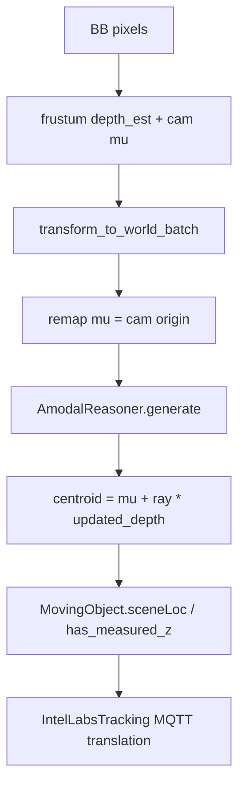

# Debug plan: Stairs observation Z offset

## Goal

Find **which stage** introduces the multi-meter Z error on Stairs (Phase 1 path), without changing production logic until the stage is identified. Work top-down: characterize → isolate pipeline vs tracker → bisect frustum vs amodal → check frame/calibration conventions.

Relevant path (already shipped):



Key code: [`observation_pipeline.py`](controller/src/controller/observation_pipeline.py), [`frustum_gaussian/__init__.py`](scene_common/src/frustum_gaussian/__init__.py), [`amodal_reasoner.py`](scene_common/src/observation_conditioning/amodal_reasoner.py), [`ilabs_tracking.py`](controller/src/controller/ilabs_tracking.py) (`zMeasured` from `has_measured_z`).

### Confirmed amodal contracts (do not second-guess during bisect)

From [`AmodalReasoner.generate`](scene_common/src/observation_conditioning/amodal_reasoner.py):

- **`mu` must be camera world origin**, not the object mean. Centroid is always `mu + ray * depth`. Passing frustum’s world object `mu` into `generate` would displace the point by ~`depth_est` meters.
- **`updated_depth` is along-ray range from that `mu`** (same units as frustum `depth_est`), after occluder/wall truncation of the depth Gaussian — not a direct floor hit and **not** an independent height prior.
- FREE_3D / no bounds → `updated_depth = depth_est` (passthrough). Amodal does **not** snap Z to floor via a height offset; world-up only orients probes/pin-drops.

Current pipeline already remaps `mu` to `pose_mat[:3,3]` before `generate`. Step 2D still verifies this at runtime (regressions here look like multi-meter Z).

---

## Step 0 — Characterize the symptom (5–10 min)

Before touching code, freeze what “off” means. Sample MQTT on `scenescape/data/scene/<stairs_uid>/person` for a person standing on a known landing (or known step height).

Record for **≥20 frames**, separately for `stair-cam-1` and `stair-cam-2` when visible alone:

| Field | Capture |
|-------|---------|
| Sign | Z too high vs too low vs oscillating |
| Magnitude | median \|ΔZ\| in meters vs expected floor height |
| Constant vs depth-dependent | ΔZ ≈ constant (pose/mesh frame) vs grows with range (depth/prior) |
| Per-camera | same ΔZ on both cams → world/mesh; only one cam → that cam K/pose/intrinsics |
| Detection vs track | compare raw conditioned point (Step 2 logs) vs MQTT `translation[2]` |

**Interpretation cheat sheet:**

- ~0.7–1.0 m high, constant → likely **centroid vs foot** (body center published; UI/ground truth is feet). Legacy path projects the **foot** of the BB onto the plane ([`mapObjectDetectionToWorld`](controller/src/controller/moving_object.py)).
- 2–5+ m, roughly constant in world → **mesh frame / camera pose Z / world-up axis**.
- Grows with distance or BB size → **shape prior / intrinsics / frustum depth**.
- Only after amodal (prior OK, updated bad) → **mesh conditioning / wrong surface hit**.

---

## Step 1 — Confirm the Stairs path is the one producing Z

1. In controller logs, confirm `ObservationPipeline: built AmodalReasoner for stair-cam-*` and conditioned-detection debug.
2. Temporarily disable the gate for one run (or rename scene off allow-list) and compare MQTT Z:
   - Gate off → legacy ground projection (often Z≈0 / planar).
   - Gate on → measured Z path.
3. If the bad Z only appears with the gate on, the bug is in observation conditioning (or how tracks consume it), not DLStreamer.

Do **not** change tracker association yet; only isolate.

---

## Step 2 — Instrument one detection through the pipeline (binary bisect)

Add temporary debug logging (or enable `AmodalReasoner.debug = True`) for a **single** camera and **one** stable BB. Log these quantities in [`ObservationPipeline.apply`](controller/src/controller/observation_pipeline.py) immediately after each stage:

| Stage | Fields | What “good” looks like |
|-------|--------|------------------------|
| A. Inputs | `cam_id`, BB xywh, `fx,fy,cx,cy,width,height`, `pose_mat[:3,3]` (cam origin), pose Z | Cam origin Z matches UI/calibration; resolution matches DLStreamer frame |
| B. Frustum (cam) | `depth_est`, `depth_lo/hi`, `mu_cam` (z), `score`, `edge_valid` | Depth ≈ expected range to person; not clip-driven `depth_lo=0` chaos |
| C. Frustum (world, before remap) | `world_obs["mu"]` XYZ, `ray`, `depth_est` | World centroid Z ≈ floor_z + ~0.85 m for standing adult (centroid), not floor or ceiling |
| D. Remap check | `gaus_rays["mu"]` vs `pose_mat[:3,3]`; also compare to `world_obs["mu"]` | `gaus_rays["mu"]` must equal cam origin; if it equals world object mean instead, expect ~range-scale Z error |
| E. Amodal | `depth_est` vs `updated_depth`, `updated_var`, Δdepth; note FREE_3D passthrough | Small/zero Δ → amodal not the mover; large Δ → occluder/wall pull (not a height prior) |
| F. Output | `centroid` XYZ written to `orig_point`, `has_measured_z` | This is what tracker ingests as `sceneLoc` |
| G. MQTT | track `translation` | Should match F within filter lag; large gap → tracker, not observation |

Optional: set `reasoner.debug = True` before `generate()` and dump `reasoner.trace["gaussian"]` / probe hits ([README debugging](scene_common/src/observation_conditioning/README.md)).

**Bisect rule:**

- Bad at **C**, good inputs **A** → frustum / prior / intrinsics.
- Good at **C**, bad at **E/F** → amodal / mesh / world-up.
- Good at **F**, bad at **G** → tracker / publish path (less likely for “few meters” static bias).

---

## Step 3 — Ordered hypotheses (confirm / kill each)

Work in this order; stop when one matches the Step 0 signature.

### H1 — Centroid vs foot convention (~0.7–1 m)

Pipeline writes the **Gaussian centroid**, not foot:

```python
centroids = gaus_rays["mu"] + gaus_rays["ray"] * updated_depth[:, None]
```

Legacy uses foot-of-BB ground intersection. **Test:** compare conditioned Z to expected floor Z; if ΔZ ≈ half of `PERSON_SHAPE_PRIOR["mu_z"]` (≈0.85 m), this is the convention mismatch, not a depth bug. Fix later would be foot-adjust; for debug, re-evaluate “expected” as torso height.

### H2 — Mesh not in the same world frame as cameras (multi-meter, often constant)

[`ObservationPipeline._mesh_tensor`](controller/src/controller/observation_pipeline.py) passes `scene.map_triangle_mesh` into `DepthMap` **without** applying `mesh_translation` / `mesh_rotation` / `mesh_scale` ([`getPoseMatrix`](scene_common/src/scene_common/transform.py)). Cameras live in scene world; GLB may still have a scene mesh pose.

**Test:**

1. Log mesh AABB min/max Z and camera origins.
2. Log `scene.mesh_translation`, `mesh_rotation`, `mesh_scale` from Stairs scene data.
3. If mesh AABB and camera footprints do not overlap in XY/Z the way the UI map shows, DepthMap hits are wrong → amodal pulls depth by meters.
4. Raycast one known pixel (person feet) with Open3D using the same extrinsics; compare hit Z to UI.

### H3 — World-up axis wrong (Y-up mesh vs Z-up assumption)

Pipeline hardcodes `DEFAULT_WORLD_UP = [0,0,1]`. Amodal pin-drop / floor logic uses this ([`_get_avg_local_ground_plane`](scene_common/src/observation_conditioning/amodal_reasoner.py)). Vendored README example uses Y-up.

**Test:** mesh extent — which axis is “height”? If mesh height is along Y but cameras use Z-up, pin-drops and wall/floor classification fail → depth jumps of meters. Compare mesh AABB and camera `pose_mat` up direction.

### H4 — Frustum depth prior wrong (shape prior / BB / intrinsics)

`PERSON_SHAPE_PRIOR` height 1.70 m drives angular-size depth. Wrong `fx/fy`, wrong resolution, or BB not full-body → depth error that grows with range and maps into Z via the ray.

**Test:**

1. Bypass amodal: set `updated_depth = depth_est` (or skip `generate`) and log world Z.
2. Perturb prior `mu_z` ±20% and see if ΔZ scales as expected for angular depth.
3. Verify BB pixels match the DLStreamer frame size used for `width/height` in intrinsics dict.

### H5 — Amodal pulls to wrong surface (wall / occluder / peeled layer)

If prior centroid Z looks right but `updated_depth` moves by meters: that shift is **occluder/wall truncation along the ray**, not a floor-height nudge. Wrong mesh frame (H2) or world-up (H3) often shows up here as bogus bounds.

**Test:** with `debug=True`, inspect `trace["occlusion"]`, wall depths, and whether `total_occ` fires. Compare camera-ray mesh hit distance at BB center to `depth_est` and `updated_depth`. If `updated_depth ≈ depth_est`, kill H5 and look at H1/H4/H6.

### H6 — Camera pose Z / extrinsics convention

`pose_mat` is camera→world everywhere in SceneScape and in `DepthMap` docs. Wrong calibrated camera height shows up as constant ΔZ on that camera only.

**Test:** UI/API camera translation Z vs logged `pose_mat[:3,3]`; single-camera-only error points here.

### H7 — Tracker / size semantics (only if F good, G bad)

[`ilabs_tracking`](controller/src/controller/ilabs_tracking.py) copies `sceneLoc` and sets `zMeasured`. Unlikely for a static few-meter bias unless filter init or asset height confuses visualization. Confirm with a one-frame dump of `sceneLoc` vs published `translation`.

---

## Step 4 — Controlled A/B runs (after instrumentation)

Run the same Stairs clip (or live minute) three ways; keep MQTT dumps:

1. **Legacy** — gate off (baseline planar / foot behavior).
2. **Frustum-only** — condition with `updated_depth = depth_est` (no mesh).
3. **Full pipeline** — current code.

Compare median Z (and XY) for a person on a flat landing. Winner of the bisect:

| Pattern | Culprit |
|---------|---------|
| Full ≈ frustum-only, both bad | Frustum / prior / K / BB (H4) or convention (H1) |
| Frustum-only good, full bad | Amodal / mesh / up-axis (H2, H3, H5) |
| Both good vs ground truth but UI looks wrong | Visualization expects feet (H1) |
| One camera only | That camera pose/K (H6) |

---

## Step 5 — Decide fix only after stage ID

Do not change priors, mesh transforms, or foot offsets until Step 4 names the stage. Typical fix mapping once identified:

- H1 → foot-adjust centroid by prior height along world-up (product decision).
- H2 → transform mesh by `getPoseMatrix(scene)` before `DepthMap`.
- H3 → derive/up-configure world-up from scene/mesh.
- H4 → fix K/resolution/BB or prior; re-check DLStreamer metadata.
- H5 → tune amodal / peel layers / occlusion for Stairs geometry.
- H6 → recalibrate camera.

---

## Success criteria for this debug effort

- Written note: sign, magnitude, per-camera, detection vs track.
- Table of Stage A–G values for one representative frame.
- Single hypothesis from H1–H7 marked confirmed with the A/B evidence.
- No production fix committed until that confirmation exists.
