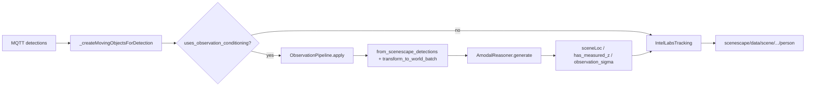

<!--
SPDX-FileCopyrightText: (C) 2026 Intel Corporation
SPDX-License-Identifier: Apache-2.0
-->

# Implementation Plan: Scenescape V2 Phase 1 — Controller Observation Pipeline (Stairs-first)

- **Author(s)**: [Sarat Poluri](https://github.com/spoluri)
- **Date**: 2026-10-22
- **Status**: Implemented (Stairs-first); live-verified on Stairs MQTT tracks
- **Source algorithms**: [`scenescape-v2-architecture`](https://github.com/intel-sandbox/scenescape-v2-architecture) (`algorithms/frustum-gaussian`, `algorithms/amodalreasoner`)
- **Related**: [ADR-0017](../../docs/adr/0017-probabilistic-tracking-association.md), [plan-probabilistic-tracking.md](./plan-probabilistic-tracking.md)
- **Commit**: `682c2a79` (`feat/full-v2-tracking-pipeline`)

This plan is the **as-built** record for Phase 1: tasks, integration points, and Stairs verification. Full architecture lives in the v2-architecture repo; ADR-0017 covers the Mahalanobis/UKF association layer reused here.

---

## Naming

**This plan’s “Phase 1”** is the end-to-end observation path:

```text
detections → frustum_gaussian → observation_conditioning (amodal) → probabilistic tracking
```

In `scenescape-v2-architecture` those stages are labeled Phases 1 / 2 / 3a–3b. Packages keep those names; only the vendored paths below changed.

**Decisions locked in (and shipped):**

- Vendored into [`scene_common/src/frustum_gaussian`](../../scene_common/src/frustum_gaussian) and [`scene_common/src/observation_conditioning`](../../scene_common/src/observation_conditioning)
- **Stairs-only** gate; legacy floor/ray projection remains the default for all other scenes

---

## As-built data flow



Hook site: [`Scene`](../../controller/src/controller/scene.py) after object creation, before `_finishProcessing` — not inside `MovingObject.mapObjectDetectionToWorld`. On Stairs, conditioning **overwrites** the legacy world location; on failure or missing mesh/reasoner, the legacy projection is left unchanged.

---

## 1. Vendored packages (`scene_common/src/`)

### `frustum_gaussian/`

| Item | As built |
|------|----------|
| Runtime kernel | Pure NumPy in [`_pure.py`](../../scene_common/src/frustum_gaussian/_pure.py); public API in [`__init__.py`](../../scene_common/src/frustum_gaussian/__init__.py) |
| C++ / pybind | Sources kept under [`cpp/`](../../scene_common/src/frustum_gaussian/cpp/) for a future scikit-build; **not** built in the controller image yet |
| SceneScape bridge | `from_scenescape_detections`, `transform_to_world_batch`, `PERSON_SHAPE_PRIOR` (~0.55×0.55×1.70 m) |
| Provenance | `NOTICE`, `README.md`, `ALGORITHM.md`, `AGENTS.md` |

Import: `import frustum_gaussian as fg`.

### `observation_conditioning/`

| Item | As built |
|------|----------|
| Public API | Lazy `from observation_conditioning import AmodalReasoner` (avoids open3d at install time in common-base) |
| Modules | `amodal_reasoner.py`, `intersection_map.py`, `constants.py` |
| Imports | Package-relative (`from .constants import ...`), not `from src....` |
| Provenance | `NOTICE`, `README.md`, `amodal_reasoner_algorithm.md` |

### Packaging / image install

- Sibling packages under `scene_common/src/` are picked up by [`scene_common/src/setup.py`](../../scene_common/src/setup.py) (`find_packages`) when the common-base image installs from that tree.
- Controller runtime explicitly copies both packages from the builder stage in [`controller/Dockerfile`](../../controller/Dockerfile):
  - `site-packages/frustum_gaussian`
  - `site-packages/observation_conditioning`

---

## 2. Controller observation path

### Gate

[`sceneUsesObservationConditioning`](../../controller/src/controller/observation_pipeline.py) — hard allow-list:

```python
OBSERVATION_CONDITIONING_SCENE_NAMES = frozenset({"Stairs"})
```

Exposed on the scene as `Scene.uses_observation_conditioning`. No scene-config / UI flag yet.

### Adapter: `ObservationPipeline`

New module: [`controller/src/controller/observation_pipeline.py`](../../controller/src/controller/observation_pipeline.py).

Wired in [`scene.py`](../../controller/src/controller/scene.py):

- `self.observation_pipeline = ObservationPipeline(self)` on construct
- After `_createMovingObjectsForDetection`, if gated: `self.observation_pipeline.apply(objects, camera, when)`
- `invalidate()` on `updateScene` and when cameras are removed

### Per-camera `AmodalReasoner` cache

Built lazily in `_reasoner_for_camera`:

- Mesh: `scene.map_triangle_mesh` (legacy Open3D mesh → tensor mesh if needed)
- Intrinsics: `fx,fy,cx,cy` + resolution from camera pose
- Extrinsics: `camera.pose.pose_mat` (camera→world)
- World-up: `[0, 0, 1]` (`DEFAULT_WORLD_UP`)
- Cache key: rounded intrinsics/resolution/pose + `id(map_triangle_mesh)`
- `num_layers=4`

### Per-frame steps (Stairs)

1. Collect pixel BBs from each `MovingObject.boundingBoxPixels`
2. `fg.from_scenescape_detections(..., shape_prior=fg.PERSON_SHAPE_PRIOR)` → camera-frame Gaussians
3. `fg.transform_to_world_batch(cam_obs, pose_mat)`
4. Remap batch to amodal `gaus_rays` with `mu` = **camera origin in world** (tiled), plus world-frame `ray` / depth / `Sigma`
5. `AmodalReasoner.generate(gaus_rays)` → `updated_depth`, `updated_var`
6. Centroid: `mu + ray * updated_depth`; write `orig_point`, `location`, `vectors`
7. `has_measured_z = True` so UKF / `zMeasured` path is used
8. Attach `observation_depth_var` and `observation_sigma` (Σ available for a later ADR R-matrix phase; tracker still uses conditioned mean + existing Mahalanobis today)

Fallback: any exception or missing reasoner/mesh → log and keep legacy projection for that frame.

### Probabilistic tracking

- No information-form multi-camera fuser (arch Phase 3a) in this slice
- Consumer remains `TimeChunkedIntelLabsTracking` / `IntelLabsTracking` + ADR-0017 Mahalanobis
- Stairs deployment requires `use_tracker: true`

---

## 3. Tests

| Suite | Path | Coverage |
|-------|------|----------|
| Frustum smoke | [`tests/sscape_tests/frustum_gaussian/`](../../tests/sscape_tests/frustum_gaussian/) | `project_frustum_batch`, `from_scenescape_detections`, `transform_to_world_batch`, empty batch |
| Gate | [`tests/sscape_tests/observation_pipeline/`](../../tests/sscape_tests/observation_pipeline/) | Stairs allow-list; non-Stairs scenes remain false |

---

## 4. Live Stairs verification (done)

Environment: empty DB, Stairs imported, cam1/cam2 DLStreamer, MQTT tracks.

Checked:

1. Rebuilt controller image; `scene` container recreated with frustum + observation_conditioning present in site-packages
2. Logs: `ObservationPipeline: built AmodalReasoner for …` and conditioned-detection debug without hard failures
3. MQTT `scenescape/data/scene/<stairs_uid>/person` — person tracks with measured Z / multi-camera `visibility` (`stair-cam-1` / `stair-cam-2`)
4. Conditioning path active only for scene name `Stairs`

---

## 5. Out of scope (next phases)

- General scene config flag / UI toggle
- Information-form multi-camera fuser (arch Phase 3a)
- Feeding full Σ into UKF `correct(..., R)` (ADR Phase 3) — fields are attached but unused by the tracker today
- Building the frustum C++ extension in the Docker image (numpy path is production for Phase 1)
- Tracker-service C++ port of frustum/amodal
- Dynamic-mesh OCE (amodal Phase 2)

---

## Key files (shipped)

| Path | Role |
|------|------|
| [`scene_common/src/frustum_gaussian/**`](../../scene_common/src/frustum_gaussian) | Vendored frustum + numpy runtime |
| [`scene_common/src/observation_conditioning/**`](../../scene_common/src/observation_conditioning) | Vendored amodal / OCE |
| [`scene_common/src/setup.py`](../../scene_common/src/setup.py) | Installs sibling packages via `find_packages` |
| [`controller/Dockerfile`](../../controller/Dockerfile) | COPY both packages into runtime image |
| [`controller/src/controller/observation_pipeline.py`](../../controller/src/controller/observation_pipeline.py) | Gate, cache, BB → conditioned world points |
| [`controller/src/controller/scene.py`](../../controller/src/controller/scene.py) | Stairs hook + invalidate |
| [`tests/sscape_tests/frustum_gaussian/`](../../tests/sscape_tests/frustum_gaussian/), [`tests/sscape_tests/observation_pipeline/`](../../tests/sscape_tests/observation_pipeline/) | Smoke / gate tests |

---

## Task checklist

| ID | Task | Status |
|----|------|--------|
| vendor-frustum | Vendor frustum-gaussian (numpy runtime + cpp sources retained); install via scene_common + controller Dockerfile COPY | Done |
| vendor-oce | Vendor amodalreasoner as `observation_conditioning`; package-relative imports; lazy `AmodalReasoner` | Done |
| controller-adapter | `ObservationPipeline` + Stairs-only gate; per-camera `AmodalReasoner` cache + invalidate | Done |
| wire-detections | Stairs: frustum → world → OCE → `sceneLoc` / `has_measured_z` (+ optional Σ attrs) into IntelLabsTracking | Done |
| tests-smoke | `tests/sscape_tests/frustum_gaussian` + `observation_pipeline` gate tests | Done |
| verify-stairs | Rebuild controller; Stairs live verify (MQTT tracks + conditioning logs) | Done |
