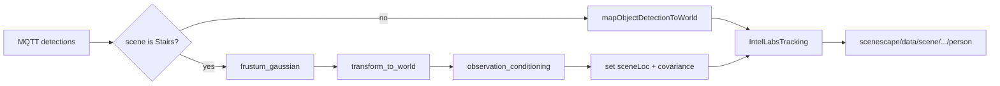

<!--
SPDX-FileCopyrightText: (C) 2026 Intel Corporation
SPDX-License-Identifier: Apache-2.0
-->

# Implementation Plan: Scenescape V2 Phase 1 — Controller Observation Pipeline (Stairs-first)

- **Author(s)**: [Sarat Poluri](https://github.com/spoluri)
- **Date**: 2026-10-22
- **Status**: Planned
- **Source algorithms**: [`scenescape-v2-architecture`](https://github.com/intel-sandbox/scenescape-v2-architecture) (`algorithms/frustum-gaussian`, `algorithms/amodalreasoner`)
- **Related**: [ADR-0017](../../docs/adr/0017-probabilistic-tracking-association.md), [plan-probabilistic-tracking.md](./plan-probabilistic-tracking.md)

This plan tracks **tasks, integration, and Stairs verification** for the V2 observation pipeline in the Scene Controller. Full architecture lives in the v2-architecture repo; ADR-0017 covers the existing Mahalanobis/UKF association layer this plan reuses.

---

## Naming

**This plan’s “Phase 1”** is the end-to-end observation path:

```text
detections → frustum_gaussian → observation_conditioning (amodal) → probabilistic tracking
```

In `scenescape-v2-architecture` those stages are labeled Phases 1 / 2 / 3a–3b. We will **not** rename those packages; we only adopt their code under the paths below.

**Decisions locked in:**

- Vendor into [`scene_common/src/frustum_gaussian`](../../scene_common/src/frustum_gaussian) and [`scene_common/src/observation_conditioning`](../../scene_common/src/observation_conditioning)
- **Stairs-only** path for verification first; legacy floor/ray projection remains the default for all other scenes

---

## What already exists

| Piece | Location | Role |
|-------|----------|------|
| Frustum-Gaussian (C++/Python) | v2-arch `algorithms/frustum-gaussian/` | BB → ray-elongated `FrustumObservation` |
| Amodal / OCE | v2-arch `algorithms/amodalreasoner/` | Mesh-conditioned depth mean/variance |
| Mesh on scene | [`scene_common/.../scene_model.py`](../../scene_common/src/scene_common/scene_model.py), controller `Scene.map_triangle_mesh` | Stairs `.glb` already loaded |
| Detection → world (legacy) | [`moving_object.mapObjectDetectionToWorld`](../../controller/src/controller/moving_object.py) | Homography / foot-ray point |
| Probabilistic tracker | `IntelLabsTracking` / `TimeChunkedIntelLabsTracking` + ADR-0017 Mahalanobis UKF (`feat/tracking-z-axis`) | Consume conditioned 3D points with `zMeasured` |

Missing today: any call into frustum or amodal before tracking.



---

## 1. Vendor algorithm packages into `scene_common`

### `scene_common/src/frustum_gaussian/`

- Copy from `~/open-edge-platform/scenescape-v2-architecture/algorithms/frustum-gaussian/` the public surface needed at runtime:
  - Python package (`python/frustum_gaussian/`), C++ sources + headers, `CMakeLists.txt` / `pyproject.toml` as needed
  - Keep ALGORITHM/README for provenance; drop or slim bulky benchmark artifacts unless cheap to keep
- Make importable as `import frustum_gaussian` from the controller image via existing scene_common install path ([`scene_common/src/setup.py`](../../scene_common/src/setup.py) + Dockerfile)
- Prefer building the C++ extension in the scene_common Docker build (same pattern as `fast_geometry`); keep the numpy fallback `_numpy.py` as safety net
- Preserve SPDX / NOTICE attribution from the source repo

### `scene_common/src/observation_conditioning/`

- Copy amodalreasoner sources into this package name:
  - `amodal_reasoner.py`, `intersection_map.py`, `constants.py`, tests
- Fix internal imports: today they use `from src.constants import ...` — rewrite to package-relative (`from observation_conditioning.constants import ...` or relative imports)
- Public API: `from observation_conditioning import AmodalReasoner`
- Dependencies already largely present (`open3d`, `numpy`, `scipy` in controller/scene_common); confirm versions vs amodal’s `open3d>0.19`

### Packaging

- Extend scene_common packaging so both packages install into the common base image used by controller
- Add unit tests under `scene_common` or controller pytest that smoke-import and run one frustum + one amodal fixture (port minimal tests from v2-arch)

---

## 2. Stairs-only observation path in the controller

### Gate

Hard-gate on scene name (or uid) **Stairs** for this iteration — e.g. helper `scene.uses_observation_conditioning` set true only when `scene.name == "Stairs"`. No general scene-config flag yet (that is the later generalization).

### Per-camera amodal cache

On scene load / camera pose update for Stairs:

- Build one `AmodalReasoner` per camera from:
  - scene `map_triangle_mesh` (tensor mesh; convert if legacy)
  - camera intrinsics (`fx,fy,cx,cy` + resolution from camera)
  - camera→world extrinsics (`pose.pose_mat`)
  - world-up (scene convention; typically `[0,0,1]` unless Stairs uses a different up)
- Invalidate/rebuild when mesh or camera pose changes

### Per-frame path (replace legacy only for Stairs detections)

Insert before / instead of point projection when creating world locations for Stairs cameras (hook near [`MovingObject.mapObjectDetectionToWorld`](../../controller/src/controller/moving_object.py) / object creation in [`scene.py`](../../controller/src/controller/scene.py) / [`tracking.createObject`](../../controller/src/controller/tracking.py)):

1. Collect 2D BBs + person shape prior (defaults from frustum ALGORITHM table: ~0.55×0.55×1.70 m)
2. `frustum_gaussian.project_frustum_batch` → camera-frame Gaussians
3. `transform_to_world_batch` with camera pose
4. Remap batch dict to amodal `gaus_rays` schema (`mu` = camera origin in world, etc.)
5. `AmodalReasoner.generate(gaus_rays)` → `updated_depth`, `updated_var`
6. Rebuild centroid: `mu + ray * updated_depth`; set `MovingObject` world translation from that centroid (or foot-adjusted if tracker expects ground contact — match existing `has_measured_z` / size handling)
7. Set `has_measured_z = True` so UKF uses 3D / `zMeasured` path in [`ilabs_tracking.py`](../../controller/src/controller/ilabs_tracking.py)
8. Optionally attach depth variance / Σ onto the object for future ADR Phase-2 combined Mahalanobis; Phase 1 verification can succeed with conditioned mean + existing `position_mahalanobis`

Fallback: if frustum/amodal throws or mesh missing, log and fall back to legacy `mapObjectDetectionToWorld` for that frame.

### Probabilistic tracking

- Do **not** reimplement information-form multi-camera fuser (architecture Phase 3a) in this slice
- Keep existing controller tracker (`TimeChunkedIntelLabsTracking` + Mahalanobis) as the Phase-1 “probabilistic tracking” consumer
- Ensure Stairs has `use_tracker: true` (already required by this branch)

---

## 3. Verification on the live Stairs deployment

Environment already prepared: empty DB, Stairs imported, cam1/cam2 DLStreamer up, MQTT tracks flowing.

Verification goals (qualitative + MQTT/UI):

- Person ascending/descending stairs stays on walkable surface (not projected through/beyond wall)
- Partial occlusion by stairs/rail does not snap person below the staircase volume
- Tracks remain continuous across cameras (`visibility` includes `stair-cam-1` / `stair-cam-2` when both see the person)
- Compare against legacy path (toggle gate off temporarily or A/B log) for the known failure modes

Concrete checks:

1. Rebuild scene_common + controller images; recreate `scene` container
2. Confirm Stairs path logs (frustum N, amodal updates) without flooding errors
3. MQTT sample on `scenescape/data/scene/<stairs_uid>/person` — inspect `translation` Z and lateral position during occlusion frames
4. UI visual check on Stairs scene
5. Capture a short before/after note (or screenshot/MQTT dump) for the “beyond wall” / “below stairs” cases

---

## 4. Out of scope (next phases)

- General scene config flag / UI toggle
- Information-form multi-camera fuser (arch Phase 3a)
- Feeding full Σ into UKF `correct(..., R)` (ADR Phase 3)
- Tracker-service C++ port of frustum/amodal
- Dynamic-mesh OCE (amodal Phase 2)

---

## Key files to touch

- New: `scene_common/src/frustum_gaussian/**`, `scene_common/src/observation_conditioning/**`
- [`scene_common/src/setup.py`](../../scene_common/src/setup.py), [`scene_common/Dockerfile`](../../scene_common/Dockerfile) / Makefile — install both packages + build extension
- [`controller/src/controller/moving_object.py`](../../controller/src/controller/moving_object.py) and/or [`scene.py`](../../controller/src/controller/scene.py) — Stairs observation path
- Small adapter module e.g. `controller/src/controller/observation_pipeline.py` — batch BB→conditioned world points (keeps moving_object thin)
- Tests: package smoke tests + controller unit test with mocked mesh/camera for Stairs path

---

## Task checklist

| ID | Task | Status |
|----|------|--------|
| vendor-frustum | Copy frustum-gaussian into `scene_common/src/frustum_gaussian`; wire build/install in scene_common image | Pending |
| vendor-oce | Copy amodalreasoner into `scene_common/src/observation_conditioning`; fix imports; install with scene_common | Pending |
| controller-adapter | Add `observation_pipeline` adapter + Stairs-only gate; per-camera `AmodalReasoner` cache | Pending |
| wire-detections | Route Stairs detections through frustum → world → OCE → `sceneLoc`/`has_measured_z` into IntelLabsTracking | Pending |
| tests-smoke | Add smoke/unit tests for packages and Stairs observation path | Pending |
| verify-stairs | Rebuild controller; Stairs live verify (MQTT/UI) for wall/stairs occlusion cases | Pending |
