### Enhanced Summary of Scenescape Requirement Clusters

**Category Legend:**
*   Core Scenescape Functionality
*   Sample / Reference Application
*   Add-on (Vertical Business Specific)
*   Parallel external functionality

---

#### Cluster 1: Scene Controller & Spatial Transform
This cluster focuses on foundational Scenescape capabilities related to scene creation, management, and interaction with the physical world through various devices, including UAVs and handhelds.

| Issue Key | Priority | Reporter | Summary & Category | Defined Pre-requisites |
|:---|:---|:---|:---|:---|
| [ITEP-94913](https://jira.devtools.intel.com/browse/ITEP-94913) | P2-High | rcallen | **Handheld Spatial AI App (Physical Agent):** Productize the PoC handheld app as a supported reference for moving cameras.  Sample / Reference Application | [ITEP-94697](https://jira.devtools.intel.com/browse/ITEP-94697) (Relates) |
| [ITEP-94697](https://jira.devtools.intel.com/browse/ITEP-94697) | P2-High | rcallen | **Demonstrate Physical Agent for UAVs:** Adapt the handheld "Physical Agent" to operate on a headless UAV.  Sample / Reference Application | [ITEP-94913](https://jira.devtools.intel.com/browse/ITEP-94913) (Blocks) |
| [ITEP-97954](https://jira.devtools.intel.com/browse/ITEP-97954) | P2-High | rcallen | **UAV Ground Control Station (GCS) Interoperability:** Integrate Scenescape with QGroundControl to enrich the map with real-time data.  Sample / Reference Application | *None specified.* |
| [ITEP-97790](https://jira.devtools.intel.com/browse/ITEP-97790) | P2-High | jgorecki | **ROI & GLB Import from Maps:** Automatically generate ROIs from OpenStreet Map and improve 3D model import and map overlays.  Core Scenescape Functionality | *None specified.* |
| [ITEP-97791](https://jira.devtools.intel.com/browse/ITEP-97791) | P2-High | jgorecki | **Trajectory Export:** Export the full trajectory of a tracked object, including video frames, via API and UI.  Core Scenescape Functionality | *None specified.* |
| [ITEP-91297](https://jira.devtools.intel.com/browse/ITEP-91297) | P2-High | jgorecki | **Non-Real-time Processing Mode:** Implement a FIFO processing mode to prevent frame loss when analytics lag behind the camera feed.  Core Scenescape Functionality | [ITEP-91296](https://jira.devtools.intel.com/browse/ITEP-91296) (Relates), [ITEP-91298](https://jira.devtools.intel.com/browse/ITEP-91298) (Relates) |
| [ITEP-81927](https://jira.devtools.intel.com/browse/ITEP-81927) | P3-Medium | robertaw | **Live ROI Dwell Time in Streaming Data:** Include real-time object dwell time within ROIs in streaming data.  Core Scenescape Functionality | [ITEP-23442](https://jira.devtools.intel.com/browse/ITEP-23442) (Relates) |
| [ITEP-81929](https://jira.devtools.intel.com/browse/ITEP-81929) | P3-Medium | robertaw | **Create Code Examples Directory:** Develop a dedicated directory of runnable code samples for common Scenescape integrations.  Sample / Reference Application | *None specified.* |
| [ITEP-93659](https://jira.devtools.intel.com/browse/ITEP-93659) | P4-Low | robertaw | **Child Model Training System:** Use an open vocabulary model to automatically train lightweight, optimized child models.  Add-on (Vertical Business Specific) | *None specified.* |

---

#### Cluster 2: Cross-Camera Tracking & Re-identification
This cluster centers on the challenges of tracking objects across multiple camera views, reconciling different classifications from various models, and benchmarking performance against other solutions.

| Issue Key | Priority | Reporter | Summary & Category | Defined Pre-requisites |
|:---|:---|:---|:---|:---|
| [ITEP-97637](https://jira.devtools.intel.com/browse/ITEP-97637) | P2-High | qding6x | **Multi-Camera Cross-Stream Tracking on DLStreamer:** Design a roadmap for cross-camera tracking in DLStreamer, evaluating different architectures.  Parallel external functionality | [ITEP-96681](https://jira.devtools.intel.com/browse/ITEP-96681) (Relates) |
| [ITEP-97763](https://jira.devtools.intel.com/browse/ITEP-97763) | P2-High | jgorecki | **Gateway vs. Smart Camera Benchmark:** Create a whitepaper and sample app benchmarking an Edge Gateway against smart cameras for AI tasks.  Parallel external functionality | *None specified.* |
| [ITEP-86125](https://jira.devtools.intel.com/browse/ITEP-86125) | P4-Low | robertaw | **Reconcile Differing Classes for a Single Object:** Resolve tracking duplication when a single object is detected with different labels by various models.  Core Scenescape Functionality | *None specified.* |

---

#### Cluster 3: LiDAR + Camera Fusion & 3D Point-Cloud Pipeline
This cluster is dedicated to integrating and fusing data from LiDAR and cameras. It covers the end-to-end pipeline, from live sensor ingestion and 3D inference to the development of applications that leverage multi-modal data.

| Issue Key | Priority | Reporter | Summary & Category | Defined Pre-requisites |
|:---|:---|:---|:---|:---|
| [ITEP-97652](https://jira.devtools.intel.com/browse/ITEP-97652) | P2-High | qding6x | **Real-Time 3D Pipeline (Cam + LiDAR):** Upgrade the existing offline-only 3D camera and LiDAR fusion pipeline to support a live, real-time sensor feed.  Parallel external functionality | [ITEP-97651](https://jira.devtools.intel.com/browse/ITEP-97651) (Blocks) |
| [ITEP-97744](https://jira.devtools.intel.com/browse/ITEP-97744) | P2-High | jgorecki | **LiDAR-Camera Fusion Application:** Develop a Scenescape-based sample application demonstrating both early and late fusion of LiDAR and camera data.  Sample / Reference Application | *None specified.* |
| [ITEP-94748](https://jira.devtools.intel.com/browse/ITEP-94748) | P3-Medium | rcallen | **UAV Collision Avoidance:** Create a collision avoidance application for UAVs using multi-sensor fusion (RGB, IR, LiDAR) and autopilot integration.  Sample / Reference Application | *None specified.* |
| [ITEP-97651](https://jira.devtools.intel.com/browse/ITEP-97651) | P4-Low | qding6x | **Integrate Optimized PointPillars Model:** Integrate the latest 10x faster, GPU-accelerated PointPillars model into the DLStreamer 3D pipeline.  Parallel external functionality | [ITEP-97648](https://jira.devtools.intel.com/browse/ITEP-97648) (Blocks) |
| [ITEP-97676](https://jira.devtools.intel.com/browse/ITEP-97676) | P4-Low | jgorecki | **3D Point Cloud Inference Pipeline (Offline):** Demonstrate 3D point cloud inference in DLStreamer using an offline dataset as the first phase.  Parallel external functionality | *None specified.* |

### Scenescape Feature Dependency Graph

Here is the dependency graph showing the relationships between the different Scenescape features. The nodes are color-coded according to the category legend above.

```mermaid
graph TD
    subgraph "Cluster 3: LiDAR + Camera Fusion"
        ITEP-97652["<a style='color:white' href='https://jira.devtools.intel.com/browse/ITEP-97652'>ITEP-97652</a>: Real-Time 3D Pipeline (Cam + LiDAR)"]
        ITEP-97744["<a style='color:white' href='https://jira.devtools.intel.com/browse/ITEP-97744'>ITEP-97744</a>: LiDAR-Camera Fusion Application"]
        ITEP-94748["<a style='color:white' href='https://jira.devtools.intel.com/browse/ITEP-94748'>ITEP-94748</a>: UAV Collision Avoidance"]
        ITEP-97651["<a style='color:white' href='https://jira.devtools.intel.com/browse/ITEP-97651'>ITEP-97651</a>: Integrate Optimized PointPillars Model"]
        ITEP-97676["<a style='color:white' href='https://jira.devtools.intel.com/browse/ITEP-97676'>ITEP-97676</a>: 3D Point Cloud Inference Pipeline (Offline)"]
    end

    subgraph "Cluster 2: Cross-Camera Tracking & Re-ID"
        ITEP-97637["<a style='color:white' href='https://jira.devtools.intel.com/browse/ITEP-97637'>ITEP-97637</a>: Multi-Camera Cross-Stream Tracking on DLStreamer"]
        ITEP-97763["<a style='color:white' href='https://jira.devtools.intel.com/browse/ITEP-97763'>ITEP-97763</a>: Gateway vs. Smart Camera Benchmark"]
        ITEP-86125["<a style='color:white' href='https://jira.devtools.intel.com/browse/ITEP-86125'>ITEP-86125</a>: Reconcile Differing Classes for a Single Object"]
    end

    subgraph "Cluster 1: Scene Controller & Spatial Transform"
        ITEP-94913["<a style='color:white' href='https://jira.devtools.intel.com/browse/ITEP-94913'>ITEP-94913</a>: Handheld Spatial AI App (Physical Agent)"]
        ITEP-94697["<a style='color:white' href='https://jira.devtools.intel.com/browse/ITEP-94697'>ITEP-94697</a>: Demonstrate Physical Agent for UAVs"]
        ITEP-97954["<a style='color:white' href='https://jira.devtools.intel.com/browse/ITEP-97954'>ITEP-97954</a>: UAV Ground Control Station (GCS) Interoperability"]
        ITEP-97790["<a style='color:white' href='https://jira.devtools.intel.com/browse/ITEP-97790'>ITEP-97790</a>: ROI & GLB Import from Maps"]
        ITEP-97791["<a style='color:white' href='https://jira.devtools.intel.com/browse/ITEP-97791'>ITEP-97791</a>: Trajectory Export"]
        ITEP-91297["<a style='color:white' href='https://jira.devtools.intel.com/browse/ITEP-91297'>ITEP-91297</a>: Non-Real-time Processing Mode"]
        ITEP-81927["<a style='color:white' href='https://jira.devtools.intel.com/browse/ITEP-81927'>ITEP-81927</a>: Live ROI Dwell Time in Streaming Data"]
        ITEP-81929["<a style='color:white' href='https://jira.devtools.intel.com/browse/ITEP-81929'>ITEP-81929</a>: Create Code Examples Directory"]
        ITEP-93659["<a style='color:white' href='https://jira.devtools.intel.com/browse/ITEP-93659'>ITEP-93659</a>: Child Model Training System"]
    end

    subgraph "External/Unloaded Dependencies"
        ITEP-91296["<a style='color:white' href='https://jira.devtools.intel.com/browse/ITEP-91296'>ITEP-91296</a>"]
        ITEP-91298["<a style='color:white' href='https://jira.devtools.intel.com/browse/ITEP-91298'>ITEP-91298</a>"]
        ITEP-23442["<a style='color:white' href='https://jira.devtools.intel.com/browse/ITEP-23442'>ITEP-23442</a>"]
        ITEP-96681["<a style='color:white' href='https://jira.devtools.intel.com/browse/ITEP-96681'>ITEP-96681</a>"]
        ITEP-97648["<a style='color:white' href='https://jira.devtools.intel.com/browse/ITEP-97648'>ITEP-97648</a>"]
    end

    classDef core fill:#4285F4,color:white;
    classDef sample fill:#34A853,color:white;
    classDef addon fill:#FBBC05,color:white;
    classDef parallel fill:#8E44AD,color:white;
    classDef external fill:#6c757d,color:white;

    class ITEP-97652,ITEP-97651,ITEP-97637,ITEP-97763,ITEP-97676 parallel;
    class ITEP-86125,ITEP-97790,ITEP-97791,ITEP-91297,ITEP-81927 core;
    class ITEP-97744,ITEP-94748,ITEP-94913,ITEP-94697,ITEP-97954,ITEP-81929 sample;
    class ITEP-93659 addon;
    class ITEP-91296,ITEP-91298,ITEP-23442,ITEP-96681,ITEP-97648 external;

    ITEP-94913 -->|Relates| ITEP-94697;
    ITEP-94697 -- "Blocks" --> ITEP-94913;
    ITEP-91297 -->|Relates| ITEP-91296;
    ITEP-91297 -->|Relates| ITEP-91298;
    ITEP-81927 -->|Relates| ITEP-23442;
    ITEP-97637 -->|Relates| ITEP-96681;
    ITEP-97652 -- "Blocks" --> ITEP-97651;
    ITEP-97651 -- "Blocks" --> ITEP-97648;
```

