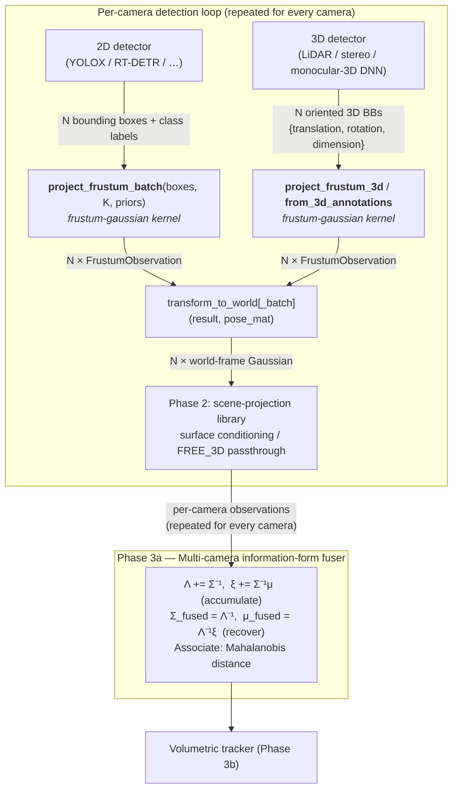

# Frustum-Gaussian: Algorithm and Architecture

> **See also:** [README](README.md) — quick-start, API reference, build instructions  
> **Benchmarks:** [benchmarks/REPORT.md](benchmarks/REPORT.md) — performance measurement across N = 1–100 detections

---

## 1. Motivation

Classical multi-camera trackers collapse each bounding box to a single 3D point by projecting the bounding-box bottom-center onto the scene plane — either via a precomputed homography or by casting a ray through the bottom-center pixel and intersecting it with a floor model. This discards almost all of the information the bounding box actually encodes.

The object's _angular subtense_ — how large it appears — is a direct measurement of its distance. Its _lateral extent_ constrains its position perpendicular to the ray. Its _clipping pattern_ (which edges reach the image border) tells us whether we are seeing the full object or only part of it. None of this is captured by a point estimate. And for objects that are not on the floor — drones, suspended items, objects being carried — the ground-plane projection gives the wrong answer entirely.

**Gaussian splat tracking** replaces the point estimate with a 3D Gaussian ellipsoid centered on the same ray. The ellipsoid is geometrically coupled to the observed bounding box:

- **Lateral axes (σ_h, σ_v):** proportional to detector edge-localization noise and orientation ambiguity at the estimated depth. Objects known to be far away are tightly constrained laterally; close objects with large pixel uncertainty are wider.
- **Depth axis (σ_d):** derived from shape-prior uncertainty and angular-measurement noise. An object whose physical size is well-known (e.g. a standard vehicle) has a much tighter depth distribution than an object of unknown size (e.g. a general package).

For sensors that provide an oriented 3D bounding box directly (LiDAR, stereo, monocular-3D DNN), `project_frustum_3d` converts it into the same `FrustumObservation` representation with a tight, properly oriented covariance — bypassing shape-prior estimation entirely.

The result is a **ray-elongated Gaussian**: narrow across the image plane (angular extent is precisely observed) and elongated along the ray (depth is estimated from shape knowledge rather than directly measured). This is exactly the right geometry for information-form multi-camera fusion, where independent ray constraints from different cameras intersect to produce a tight 3D estimate.

Compared with point tracking, this approach provides:

| Capability | Point estimate | Gaussian splat |
|---|---|---|
| Uncertainty representation | None | Full 3×3 covariance |
| Multi-camera fusion | Heuristic weighting | Mathematically principled (information form) |
| Occlusion reasoning | Ad hoc | σ_d encodes depth ambiguity directly |
| Physical size consistency | Ignored | Enforced via shape prior |
| 3D detector input (LiDAR, stereo, DNN) | Discards orientation | Native oriented covariance |
| Representation for FREE_3D objects (drones) | Requires ground hit | Works natively |

---

## 2. Algorithm

### 2.1 Inputs

| Symbol | Type | Description |
|--------|------|-------------|
| `bb` | `BoundingBox` | Pixel bounding box `[u_min, v_min, u_max, v_max]` |
| `K` | `Intrinsics` | Pinhole camera: `(fx, fy, cx, cy, width, height)` |
| `prior` | `ShapePrior` | Expected 3D physical size `(μ_x, μ_y, μ_z)` and 1-σ uncertainty `(σ_x, σ_y, σ_z)` in meters |
| `noise` | `DetectorNoise` | Detector edge-localization noise `σ_px` (pixels; default 2 px) |
| `range_m` | `float` | Optional range to the nearest visible surface (meters); interpreted per `sensor.convention` |
| `sensor` | `RangeSensorConfig` | Optional range sensor calibration: `σ_m`, `range_min_m`, `range_max_m`, `convention` |

`sigma = 0` in a `ShapePrior` activates the auto-prior: the library substitutes
`sigma = mu × 0.40`, representing a ±40 % size spread for that dimension.

A `range_m` value is valid when finite and within `(sensor.range_min_m, sensor.range_max_m]`.
Invalid or absent range measurements are silently ignored; the projection falls back to
angular-only estimation.

**Range convention.** Ranging sensors report distance in one of two conventions, selected by
`sensor.convention`:

- `CARTESIAN_DEPTH` (default) — perpendicular distance from the surface to the camera's image
  plane, i.e. the z-coordinate in the camera frame (the cathetus). Stereo and structured-light
  depth cameras report this; **Intel RealSense in particular emits a Cartesian z-depth map, not
  slant range.**
- `SLANT_RANGE` — Euclidean distance from the camera origin to the surface along the line of
  sight (the hypotenuse). Scanning LiDAR, radar, and single-point ToF report this.

The library works internally in slant range along the center ray. A `CARTESIAN_DEPTH`
measurement $z$ is converted to slant range $r$ using the forward (z) component of the unit
center ray $\hat{r}$:

$$r = \frac{z}{\hat{r}_z} \qquad \text{(since } z = r\,\hat{r}_z\text{)}$$

The correction grows toward the image periphery, where $\hat{r}_z < 1$, and vanishes on the
optical axis. Range validation (`range_min_m`/`range_max_m`) is applied to the raw reported
value in the sensor's native convention, before conversion.

### 2.2 Step-by-step derivation

**Step 1 — Edge clipping detection**

Each of the four bounding-box edges is tested against the image boundary
(within `CLIP_MARGIN_PX = 3` pixels). A clipped edge means the true object extent is not
fully visible on that side. Clipping status propagates to all downstream steps and is exposed
in `edge_valid` for use by downstream consumers.

**Step 2 — Normalized image-plane coordinates**

The box corners are back-projected through the camera intrinsics to the normalized image plane
(z = 1):

$$x_n = \frac{u - c_x}{f_x}, \quad y_n = \frac{v - c_y}{f_y}$$

The center of the box gives the center-ray direction:

$$\hat{r} = \text{normalize}\bigl(x_n^c,\; y_n^c,\; 1\bigr)$$

**Step 3 — Orientation-agnostic shape bounds**

Because the object's orientation relative to the camera is unknown, any of its three physical
dimensions `(μ_x, μ_y, μ_z)` could subtend the observed angular extent in either image
direction. The library therefore computes orientation-inclusive bounds:

$$d_{\text{lo}} = \max\bigl(\epsilon,\; \min_k (\mu_k - \sigma_k)\bigr), \quad
  d_{\text{hi}} = \max_k (\mu_k + \sigma_k)$$

$$d_{\text{est}} = (d_{\text{lo}} + d_{\text{hi}}) / 2, \quad
  \sigma_{\text{orient}} = (d_{\text{hi}} - d_{\text{lo}}) / 2$$

The combined size uncertainty merges orientation ambiguity and per-axis prior uncertainty:

$$\sigma_{\text{dim}} = \sqrt{\sigma_{\text{orient}}^2 + \max_k(\sigma_k)^2}$$

**Step 4 — Angular subtenses (exact, wide-angle safe)**

Because the pinhole projection is nonlinear, angular extents are computed with `atan` rather
than small-angle approximation:

$$\alpha_x = \arctan(x_{n,\text{max}}) - \arctan(x_{n,\text{min}}), \quad
  \alpha_y = \arctan(y_{n,\text{max}}) - \arctan(y_{n,\text{min}})$$

Only unclipped axes contribute a valid angular measurement.

Angular measurement noise (two independent edges, each ±σ_px):

$$\sigma_{\alpha_x} = \frac{\sqrt{2}\,\sigma_{\text{px}}}{f_x}, \quad
  \sigma_{\alpha_y} = \frac{\sqrt{2}\,\sigma_{\text{px}}}{f_y}$$

**Step 5 — Depth estimation via angular size**

For each unclipped axis, depth is estimated from the physical-size-to-angular-extent ratio:

$$d_k = \frac{d_{\text{est}}}{2\tan(\alpha_k/2)}$$

Uncertainty is propagated from both size uncertainty and angular measurement noise:

$$\sigma_{d_k}^2 = \left(\frac{\sigma_{\text{dim}}}{2\tan(\alpha_k/2)}\right)^2
                + \left(\frac{d_{\text{est}} \cdot \sigma_{\alpha_k}}{4\sin^2(\alpha_k/2)}\right)^2$$

**Step 6 — Information-form depth fusion**

Independent horizontal and vertical depth estimates are fused in information (inverse-variance)
form:

$$\hat{d} = \frac{\lambda_x d_x + \lambda_y d_y}{\lambda_x + \lambda_y}, \quad
  \lambda_k = \sigma_{d_k}^{-2}, \quad
  \sigma_d^2 = (\lambda_x + \lambda_y)^{-1}$$

When only one axis is unclipped, only that estimate is used. When both are clipped (object
fully fills the frame), no finite-variance angular estimate exists — but the depth is **not**
unbounded. The object must over-fill the frame, so it is constrained to the geometric interval
$[d_{\text{near}}, d_{\text{far}}]$ from Step 7 (with $d_{\text{near}} = 0$). The far bound is
the distance at which the object's largest plausible dimension is exactly subtended by the
frame. The library models the residual ignorance as a uniform distribution on that interval
(maximum entropy on a bounded support):

$$\hat{d} = \tfrac{1}{2}(d_{\text{near}} + d_{\text{far}}), \quad
  \sigma_d = \frac{d_{\text{far}} - d_{\text{near}}}{\sqrt{12}}$$

This keeps the ray-elongated Gaussian finite and correctly scaled to the largest-dimension
distance limit, rather than collapsing to an arbitrary fixed depth with $\sigma = \infty$.

**Step 6a — Range-augmented fusion (optional)**

When a valid range measurement is available it is first converted to slant range $r$ along the
center ray per `sensor.convention` (identity for `SLANT_RANGE`; $r = z/\hat{r}_z$ for
`CARTESIAN_DEPTH`, §2.1). A second depth estimate is then derived from it:

$$d_r = r + \tfrac{1}{2}\,d_{\text{est}}, \quad
  \sigma_{d_r} = \sqrt{\sigma_m^2 + \bigl(\tfrac{1}{2}\sigma_{\text{dim}}\bigr)^2}$$

Here $d_{\text{est}}/2$ converts the near-surface slant range to an estimate of the centroid
depth, and the combined uncertainty adds range-sensor noise and size-prior uncertainty in
quadrature. The range-derived estimate is then fused with the angular estimate from Step 6
in the same information form:

$$\hat{d}_{\text{fused}} = \frac{\lambda_\text{ang}\,\hat{d} + \lambda_r\,d_r}
                                 {\lambda_\text{ang} + \lambda_r}, \quad
  \sigma_{d,\text{fused}}^2 = (\lambda_\text{ang} + \lambda_r)^{-1}$$

Additionally, the range measurement tightens the geometric depth bounds (Step 7):

$$d_{\text{near}} \leftarrow \max(d_{\text{near}},\; r), \quad
  d_{\text{far}}  \leftarrow \min(d_{\text{far}},\; r + d_{\text{hi}})$$

The fused centroid estimate is then clamped to $`[d_{\text{near}}, d_{\text{far}}]`$ to maintain the invariant $`d_{\text{near}} \le \hat{d}_{\text{fused}} \le d_{\text{far}}`$.

**Step 7 — Depth bounds (Gaussian equivalent of near/far planes)**

Rather than hard near/far clip planes, the library computes soft geometric depth bounds from
the shape prior and observed angular subtense:

$$d_{\text{near}} = \frac{d_{\text{lo}}}{2\tan(\alpha_k/2)} \quad \text{(unclipped axes only)}$$

$$d_{\text{far}} = \min_k \frac{d_{\text{hi}}}{2\tan(\alpha_k/2)} \quad \text{(all axes)}$$

These bounds reflect the following geometry:

- **Far bound** (`depth_hi`): The observed bounding box cannot subtend more than the true
  silhouette on any axis. Therefore `dim_hi / (2·tan(α_obs/2))` is a valid upper bound on
  true depth regardless of clipping. A partially clipped box gives a _looser_ (larger) far
  bound, never an invalid one.
- **Near bound** (`depth_lo`): Only derivable when _both_ edges on an axis are unclipped.
  Requires the full angular extent to conclude the object cannot be arbitrarily close.
  Clipped edges set the near bound to zero (unknown).

This is the Gaussian analogue of a rendering near/far clip plane: instead of geometry being
hard-rejected outside a depth range, the Gaussian's σ_d naturally encodes depth uncertainty,
and `[depth_lo, depth_hi]` provides the caller with the geometrically supported range for
downstream reasoning such as inter-camera consistency checks or terrain intersection.

**Step 8 — 3D Gaussian covariance**

Lateral uncertainties at the estimated depth:

$$\sigma_h = \hat{d}\,\frac{\sigma_{\text{px}}}{f_x} + \frac{\sigma_{\text{dim}}}{2}, \quad
  \sigma_v = \hat{d}\,\frac{\sigma_{\text{px}}}{f_y} + \frac{\sigma_{\text{dim}}}{2}$$

The first term, $\hat{d}\,\sigma_{\text{px}}/f$, is the perspective-proportional component: one pixel of edge-localization error corresponds to $d/f$ meters of physical displacement at depth $d$, so the lateral Gaussian widens **linearly with depth** — exactly as a frustum does. This is not an approximation; it follows directly from the pinhole geometry. An object 20 m away that is detected with 2 px edge noise has ≈40 mm of lateral uncertainty, while the same detector on the same class at 100 m gives ≈200 mm.

The second term, $\sigma_{\text{dim}}/2$, represents shape-prior uncertainty and is constant in meters — it does not grow with distance.

Note that the **depth** uncertainty in Step 5 also scales with distance, but faster than linearly. At small angular extent $\alpha \approx D/d$, the depth uncertainty from angular noise is $\sigma_d^{\text{angular}} \approx d^2 \sigma_{\alpha} / D$, growing **quadratically** with depth. This is the fundamental reason depth estimation from image alone degrades rapidly beyond a few multiples of the object size: a car at 100 m that is 4.5 m long subtends only 2.6° and a 2-px angular error translates to roughly 6 m of depth uncertainty, while the same car at 20 m gives 0.25 m.

An orthonormal frame is built around the center ray $\hat{r}$:

$$\mathbf{e}_h = \hat{r} \times \hat{z}_{\text{up}} / \|\cdot\|, \quad
  \mathbf{e}_v = \hat{r} \times \mathbf{e}_h$$

The 3×3 covariance is assembled in eigendecomposition form (guaranteed PSD):

$$\Sigma_{\text{cam}} = \sigma_h^2\,\mathbf{e}_h\mathbf{e}_h^\top
                      + \sigma_v^2\,\mathbf{e}_v\mathbf{e}_v^\top
                      + \sigma_d^2\,\hat{r}\hat{r}^\top$$

**Step 9 — Quality score**

$$\text{score} = \frac{\Sigma_{\text{char}}^2}{\Sigma_{\text{char}}^2 + \sigma_d^2}, \quad
  \Sigma_{\text{char}} = 30\;\text{m}$$

Score approaches 1 for well-constrained close objects, and 0 for deeply uncertain detections.
Consumers can use the score as an observation weight in the downstream information-form fuser.

---

### 2.3 Direct 3D bounding-box projection (`project_frustum_3d`)

When a 3D detector (LiDAR, stereo, monocular-3D DNN, or a foundation model) provides a full **3D oriented bounding box** directly, depth does not need to be inferred from angular size. "Oriented" here means a box with an arbitrary **3-DOF rotation** in 3D space — expressed as a quaternion or rotation matrix — not a 2D axis-aligned or yaw-only rotated rectangle. The `project_frustum_3d` function accepts the box center, half-extents, and full 3×3 rotation matrix in the camera frame and produces a `FrustumObservation` with a tight, properly oriented covariance.

#### Inputs

| Symbol | Description |
|--------|-------------|
| $\mathbf{t}$ | Geometric center of the box in the camera frame (m) |
| $[a, b, c]$ | Half-sizes (half-extents) of the box in its body frame (m) |
| $R$ | Rotation matrix $R_{\text{body}\to\text{cam}}$, row-major 3×3 |
| $[\sigma_x, \sigma_y, \sigma_z]$ | 1-σ position uncertainty per body axis (m). Isotropic fallback: scalar $\sigma_r$ applied to all three axes |

#### Center convention

`project_frustum_3d` always takes the **geometric center** — the centroid of all 8 corners.
This matches the nuScenes, Waymo, and OpenPCDet convention ($`\text{corners\_z} = \pm h/2`$).

KITTI-convention monocular detectors (SMOKE, MonoCon, PGD, CenterNet3D, …) report the
**bottom-center** instead ($`\text{corners\_z} = [0 \ldots h]`$). Convert before calling:

$$\mathbf{t}_{\text{center}} = \mathbf{t}_{\text{bottom}} + R\,[0,\; 0,\; h/2]^\top$$

#### Pixel-resolution floor for camera-based 3D detectors

The `body_sigmas` are metric values that encode the 3D detector's localization uncertainty in each body axis. For LiDAR and radar the lateral resolution is set by beam divergence and scan density and can be well below 1 cm — sub-pixel accuracy is achievable. For **camera-based** 3D detectors (monocular DNN, stereo, structured light) the lateral uncertainty is physically bounded below by pixel size:

$$\sigma_{\text{lateral,min}} \approx \frac{d}{f}\,\sigma_{\text{px}}$$

At depth 50 m with $f = 946$ px and $\sigma_{\text{px}} = 1$, this floor is ≈ 53 mm. Providing `body_sigmas` below this value for image-based methods produces a Gaussian that is tighter than the image resolution supports. The library does not enforce this floor — it is the caller's responsibility to supply body_sigmas consistent with the detector's actual distance-dependent uncertainty profile. A practical rule: for monocular or stereo 3D detectors, set lateral body_sigmas to at least $d / f_{\text{min}} \cdot \sigma_{\text{px}}$.

The 2D path (`project_frustum`) applies this scaling automatically — the term $\hat{d}\,\sigma_{\text{px}}/f$ is computed from the estimated depth, so the lateral Gaussian is always physically consistent with the image resolution.

**Step 1 — Center ray and depth estimate**

$$\hat{r} = \mathbf{t} / \|\mathbf{t}\|, \qquad d_{\text{est}} = \|\mathbf{t}\|$$

Unlike the 2D path, depth is known from the translation; no shape-prior inference needed.

**Step 2 — Anisotropic covariance in camera frame**

The detector uncertainty $[\sigma_x, \sigma_y, \sigma_z]$ is expressed in the body frame.
Rotating to the camera frame gives a full 3×3 covariance:

$$\Sigma_{\text{cam}} = R\,\text{diag}(\sigma_x^2, \sigma_y^2, \sigma_z^2)\,R^\top$$

For isotropic noise ($\sigma_x = \sigma_y = \sigma_z = \sigma_r$) this reduces to
$\Sigma_{\text{cam}} = \sigma_r^2 I$ regardless of orientation — a sphere of uncertainty.
For anisotropic noise (e.g. LiDAR with finer lateral than range resolution), the covariance
ellipsoid is genuinely oriented in the camera frame.

**Step 3 — Depth uncertainty along the ray**

$$\sigma_d = \sqrt{\sum_i \bigl(\sigma_i \cdot (\mathbf{col}_i(R) \cdot \hat{r})\bigr)^2}$$

This is the exact projection of the body-frame uncertainty onto the camera ray direction.
For isotropic noise it reduces to $\sigma_d = \sigma_r$.

**Step 4 — Depth bounds via box support function**

The support function of the oriented box in the ray direction $\hat{r}$ gives the half-depth
extent of the box:

$$h(\hat{r}) = a\,|\mathbf{col}_0(R)\cdot\hat{r}| \;+\; b\,|\mathbf{col}_1(R)\cdot\hat{r}| \;+\; c\,|\mathbf{col}_2(R)\cdot\hat{r}|$$

Depth bounds then account for both box volume and position uncertainty:

$$d_{\text{lo}} = \max(0,\; d_{\text{est}} - h(\hat{r}) - \sigma_d), \qquad
  d_{\text{hi}} = d_{\text{est}} + h(\hat{r}) + \sigma_d$$

**Step 5 — Score and edge validity**

The quality score uses the same Cauchy formula as the 2D path (§2.2, Step 9) with $\sigma_d$
from Step 3. Because a 3D detector is not bounded by the image frame, `edge_valid` is always
set to `EDGE_ALL`.

---

## 3. Downstream consumers

This library is a **pure projection kernel**: it converts 2D bounding boxes (or 3D oriented bounding boxes) into 3D Gaussian observations and stops there. Decisions about object modes, surface constraints, and temporal integration are the responsibility of the Phase 2 tracking layer.

### 3.1 Phase 2 — scene-projection library (planned)

The outputs of `project_frustum_batch` are consumed by a dedicated Phase 2 library (`scene-projection`, to be developed as a separate optimized component) that applies scene-specific constraints:

- **Surface-contact conditioning:** For objects in contact with a known surface (floor, shelf, ground), the center ray is intersected with the scene mesh or terrain model and the Gaussian is conditioned on the resulting contact-point z-coordinate. This is the primary depth-resolution mechanism for the majority of tracked objects and is far more powerful than the shape prior alone.
- **FREE_3D passthrough:** Objects with no assumed surface contact (drones, suspended items, objects of unknown posture) are passed through unconditioned. Their depth is resolved by multi-camera ray intersection and/or velocity-bounded temporal filtering.
- **Upright-axis flag:** A per-class learnable flag indicating whether the object's longest dimension is approximately vertical. When validated from sufficient unoccluded observations, this tightens σ_z conditioning after the surface hit. It is a learned refinement, not an a priori assumption — the default is to leave σ_z at the prior width.
- **Temporal constraints:** Velocity bounds (derived from world-coordinate displacement across frames), size refinement from unoccluded traversals, and maximum observed extent are maintained in tracker state and fed back as tightened shape priors on subsequent calls to `project_frustum_batch`.

The `depth_lo`, `depth_hi`, `ray`, and `score` fields in `FrustumObservation` are the primary interface between this library and the Phase 2 layer. See §6 for the full field reference.

> **Note:** The Phase 2 scene-projection library does not exist yet. Its interface, parallelism strategy, and surface-intersection kernel will require the same performance characterization applied to this library. A separate benchmarking effort is needed.

---

## 4. Pipeline Architecture



`project_frustum_batch` sits at the innermost loop boundary. Its latency directly determines the minimum camera-frame processing delay and therefore the maximum supportable camera count at a given frame rate.

### 4.1 Deployment scenarios

The following table characterizes expected `N` values and the resulting execution path
(scalar = TBB overhead avoided; TBB = parallel threads invoked):

| Cameras | Detections/cam | Total N | Execution path |
|---------|---------------|---------|----------------|
| 1 | 5–40 | 5–40 | Opt scalar |
| 2 | 5–30 | 10–60 | Opt scalar |
| 2 | 30–40 | 60–80 | TBB active |
| 4 | 5–15 | 20–60 | Opt scalar |
| 4 | 16–40 | 64–160 | TBB throughout |
| 8+ | any | 65+ | TBB throughout |

The `PARALLEL_THRESHOLD = 64` is the empirically validated switch point on Intel Core Ultra hardware. See [benchmarks/REPORT.md](benchmarks/REPORT.md) for the full characterization.

### 4.2 Typical scene-class shape priors

These are the initial class-level priors passed to `project_frustum_batch`. The Phase 2
scene-projection library determines whether surface-contact conditioning applies; this
library treats all classes identically.

| Class | μ_x (m) | μ_y (m) | μ_z (m) | σ_z (m) | Depth range | Phase 2 mode |
|-------|---------|---------|---------|---------|-------------|-------------|
| Pedestrian | 0.55 | 0.55 | 1.70 | 0.15 | 5–20 m | Scene-projected |
| Cyclist | 0.65 | 1.10 | 1.60 | 0.10 | 5–30 m | Scene-projected |
| Car | 2.00 | 4.50 | 1.50 | 0.20 | 5–50 m | Scene-projected |
| Bus | 2.50 | 9.00 | 3.20 | 0.30 | 5–60 m | Scene-projected |
| Drone | 0.30 | 0.30 | 0.20 | 0.05 | 3–40 m | FREE_3D |
| Bird | 0.40 | 0.25 | 0.15 | 0.05 | 3–50 m | FREE_3D |
| Aircraft | 15.0 | 12.0 | 4.0 | 2.0 | 20–500 m | FREE_3D |
| Retail product | 0.12 | 0.08 | 0.20 | 0.12 | 0.5–8 m | FREE_3D |

Approximately 30% of detections in a typical street scene have at least one clipped edge — that is, the bounding box touches or reaches the image border, meaning part of the object extends outside the camera's field of view. The library handles all such image-extent clipping combinations gracefully, tightening or widening depth bounds as geometrically appropriate. Occlusion by scene structure (buildings, foliage) or by other objects is not detected here and must be handled downstream, for example by flagging detections whose shape-prior depth estimate is inconsistent with neighboring geometry.

The retail scenario is a notably different operating point: objects are small, close, and in constant motion as people pick them up, carry them, and set them down. Because a product can be held at any height from waist to overhead, surface-contact conditioning is not applicable — hence FREE_3D. The wide σ_z (0.12 m) reflects the enormous variety of product heights within a single detection class. Size refinement from unoccluded traversals (§3.1) is particularly valuable here: a camera with a clear view of a product moving across a shelf can tighten the shape prior well below the class-level default within a few frames.

---

## 5. Design Decisions

### 5.1 Why information-form fusion, not point fusion?

Because each camera contributes a different _ray direction_, the per-camera Gaussians are statistically independent. Linear (mean/covariance) fusion with independence assumption gives the same result as information-form addition, but information-form addition requires no matrix inverse per observation — each camera simply accumulates Λ and ξ in O(9) additions, and the inverse is taken once per fused object per frame.

### 5.2 Why orientation-agnostic depth?

Objects can face any direction; the sensor provides no heading information from a single bounding box. Using the full `[dim_lo, dim_hi]` range accounts for all possible orientations without requiring a heading estimate. A heading prior from tracker state could tighten the depth estimate, but only after data association — which requires projections to already exist for gating. The practical flow is therefore: project orientation-agnostically first, associate detections to tracks, then optionally re-project with the matched track's heading prior for a refined covariance used in the update step. Alternatively, a predicted track state can be re-projected into the image frame to generate a predicted bounding box, which is then used to gate and associate incoming detections — making the heading prior useful for association without requiring it beforehand.

### 5.3 Why atan-based angular subtense instead of small-angle?

For cameras with FOV greater than about 50° the small-angle approximation (α ≈ Δu / f) introduces a depth error of 3–5 % at the image edges. With fx = 1371 px on a 1920 px sensor (FOV ≈ 70°), this amounts to a 0.5–1.5 m error at 30 m — comparable to a full lane width at freeway speeds. The `atan` form is exact for any FOV and costs only two extra trig evaluations per detection.

### 5.4 Why Cauchy-type score instead of Gaussian?

The Cauchy decay `Σ_char² / (Σ_char² + σ_d²)` with `Σ_char = 30 m` produces a score that decreases slowly for moderate depth uncertainty (σ_d < 10 m) and saturates toward zero for deeply uncertain detections (σ_d > 100 m). A Gaussian decay would over-penalise moderately uncertain observations that still carry useful directional information.

### 5.5 Why no detector-resolution ceiling on `depth_hi`?

An earlier revision added `DetectorNoise.min_box_px` (default 16 px for YOLO-family detectors) as a hard upper bound on depth: if the detector cannot fire below a minimum box edge in pixels, then $d_{\text{res}} = \textit{dim}_{\text{lo}} \cdot f / \textit{min\_box\_px}$ would cap `depth_hi` independently of the observed box geometry. That approach was reverted.

The observed bounding box already carries resolution information implicitly: a detection cannot exist if the object were too small or too distant to subtend the box. Intersecting an external `min_box_px` heuristic into `depth_hi` mixes a detector engineering parameter into a purely geometric bound and does not tighten the result in any regime where depth estimation is already reliable. The far bound therefore remains solely

$$\textit{depth\_hi} = \min\!\bigl(\textit{dim\_hi}/(2\tan(\alpha_x/2)),\; \textit{dim\_hi}/(2\tan(\alpha_y/2))\bigr).$$

---

## 6. Output Reference

```cpp
struct FrustumObservation {
    float mu[3];        // 3D position mean in camera frame [x, y, z] (m)
    float Sigma[9];     // 3×3 covariance, row-major (m²)
    float ray[3];       // unit center ray [dx, dy, dz] in camera frame
    float depth_est;    // MAP depth estimate along ray (m)
    float depth_sigma;  // 1-σ depth uncertainty (m)
    float depth_lo;     // soft near bound: object is probably beyond this (m)
    float depth_hi;     // soft far bound: object is probably within this (m)
    float score;        // depth constraint quality ∈ [0, 1]
    uint8_t edge_valid; // bit-mask: which bb edges are unclipped
};
```

After `transform_to_world()` all fields except `edge_valid` are expressed in the world frame.
The `ray` field is rotated (not translated) — it remains a direction vector.

---

## 7. References

- [README](README.md) — quick-start, C++ and Python APIs, build instructions
- [benchmarks/REPORT.md](benchmarks/REPORT.md) — full performance characterization, N = 1–100
- SceneScape-ng Phase 2 integration: `controller/multiview_projection.py`
- SceneScape-ng Phase 3a fuser: `controller/fuser.py`
- Eigen3 — [https://eigen.tuxfamily.org](https://eigen.tuxfamily.org)
- Intel oneTBB — [https://github.com/oneapi-src/oneTBB](https://github.com/oneapi-src/oneTBB)
